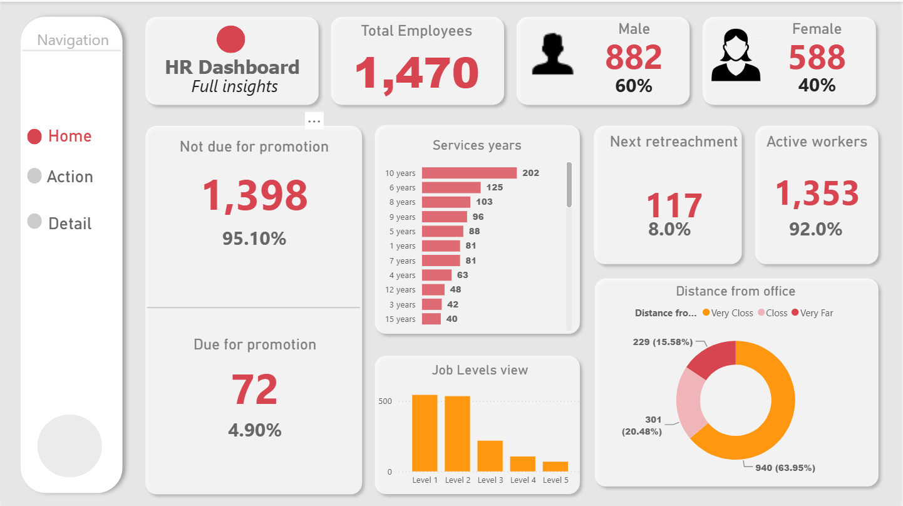
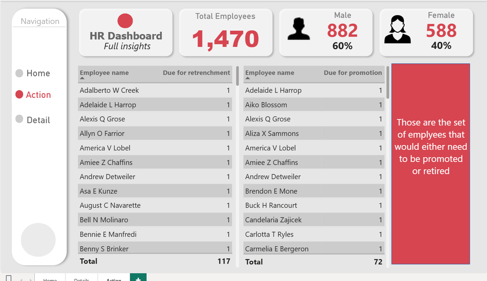
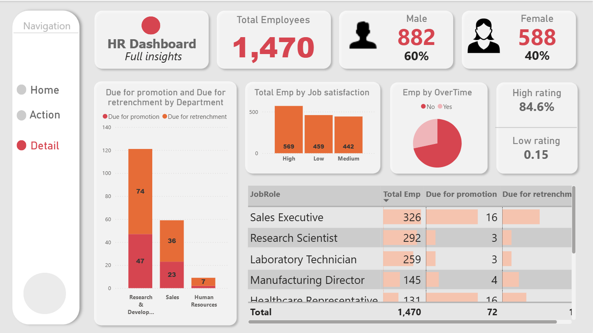

# HR Analytics Dashboard

## Project Overview

This project is an interactive HR Analytics Dashboard developed using Microsoft Power BI. The dashboard provides insights into workforce demographics, employee satisfaction, promotion eligibility, retrenchment, and employee performance.

It helps HR teams monitor employee-related metrics, identify workforce trends, and support data-driven human resource decisions.

## Tools & Technologies

- Microsoft Power BI
- Power Query
- DAX
- Microsoft Excel

## Dashboard Pages

### 1. Home – HR Overview

Provides a general overview of the organization's workforce and employee statistics.

**Key Performance Indicators (KPIs):**
- Total Employees
- Male Employees
- Female Employees
- Active Workers
- Employees Due for Promotion
- Employees Not Due for Promotion
- Next Retrenchment

**Visualizations:**
- Employee Distribution by Gender
- Years of Service Analysis
- Job Level Distribution
- Distance from Office
- Employee Status Overview

### 2. Action – Employee Action Analysis

Focuses on employees who may require HR action, including promotion and retrenchment.

**Key Features:**
- Employees Due for Promotion
- Employees Due for Retrenchment
- Employee Lists and Details
- Department-wise Promotion and Retrenchment Analysis

This page helps HR teams identify employees who may require promotion or workforce-related decisions.

### 3. Detail – Employee Performance Analysis

Provides a deeper analysis of employee satisfaction and workforce characteristics.

**Visualizations:**
- Employee Count by Job Satisfaction
- Employee Distribution by Overtime
- Employee Ratings
- Promotion and Retrenchment by Department
- Job Role Analysis

## Key Features

- Interactive page navigation
- Employee filtering and analysis
- Workforce demographic analysis
- Promotion and retrenchment monitoring
- Employee satisfaction analysis
- Job level and service years analysis
- Dynamic KPI cards
- Interactive charts and tables

## Project Objectives

- Analyze workforce demographics.
- Monitor employee satisfaction.
- Identify promotion opportunities.
- Evaluate employee retention and retrenchment.
- Understand workforce distribution across departments.
- Support data-driven HR decision-making.

## Dashboard Screenshots

### Home Page

### Action Page

### Detail Page

**Author:** heydarova000  
**Project:** HR Dashboard
